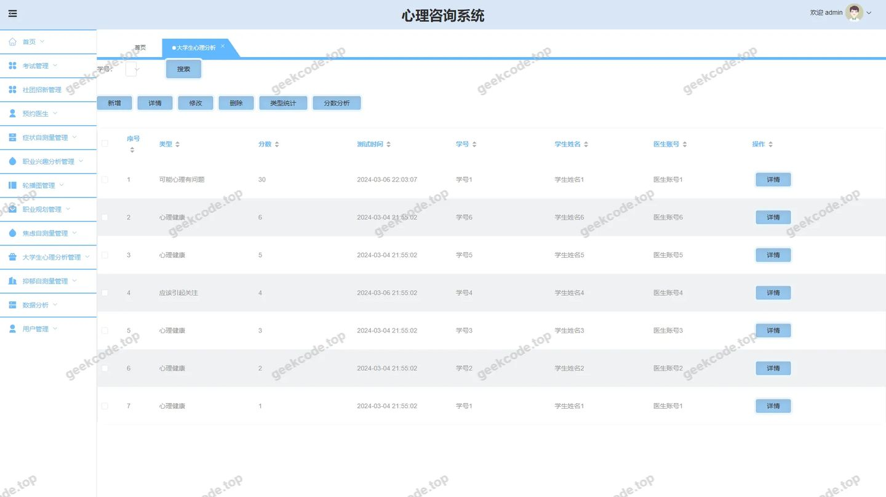
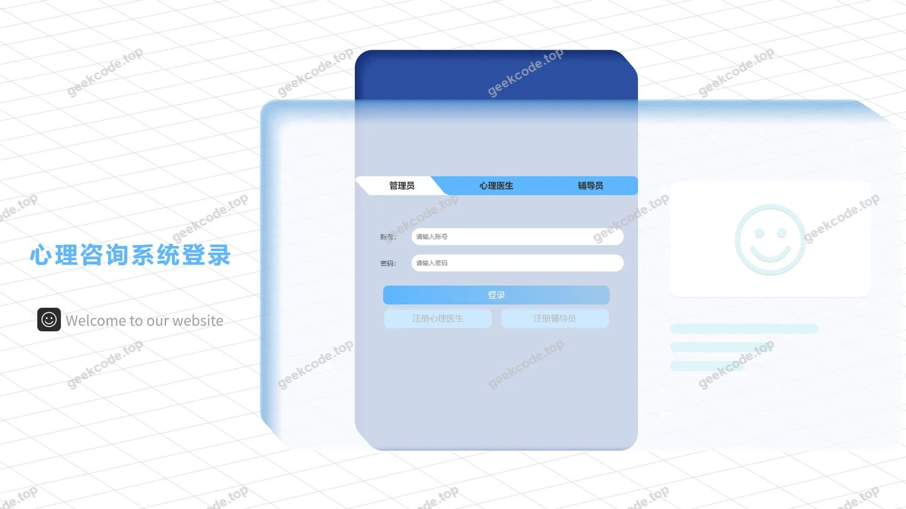
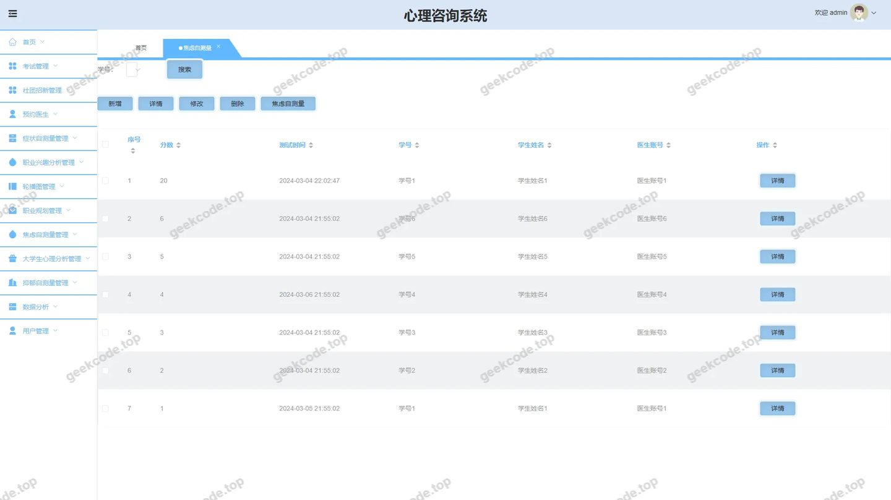
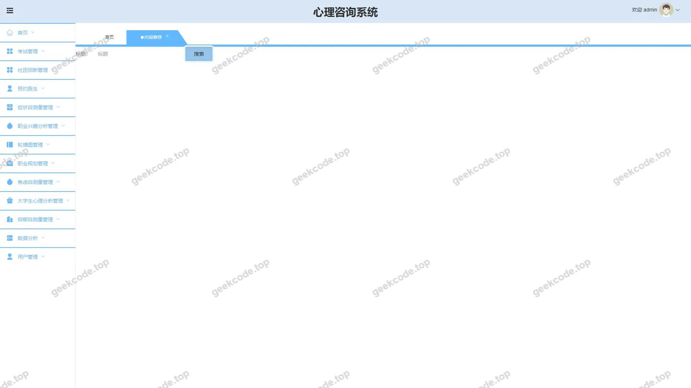
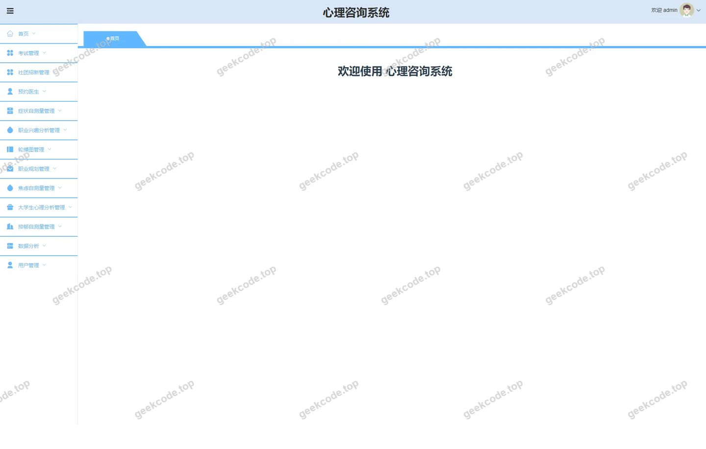
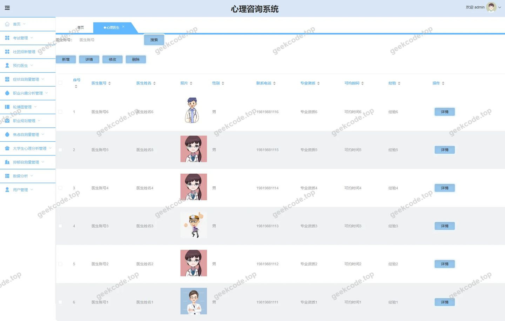
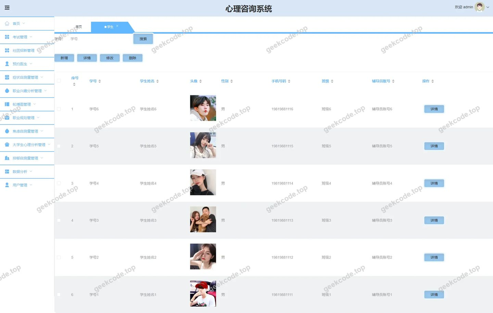
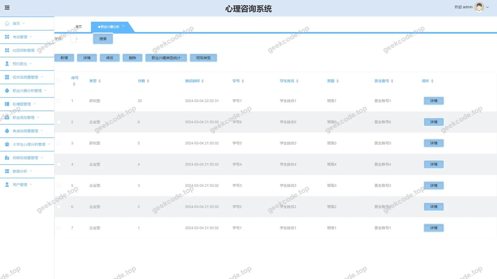

# Java心理咨询系统

> 🎓 **计算机毕业设计 · Java心理咨询系统**
>
> 本仓库只放**项目介绍 + 运行截图**（截图是站点带水印的原图，存在仓库 `images/` 里）。
>
> 👉 **完整可运行源码 / 数据库脚本 / 部署文档：[点我获取](https://geekcode.top/archives/Java%E5%BF%83%E7%90%86%E5%92%A8%E8%AF%A2%E7%B3%BB%E7%BB%9F?utm_source=github)**
>
> 💬 咨询微信：**ir9372**　|　🌐 更多项目：[极客代码 geekcode.top](https://geekcode.top/?utm_source=github)
>
> 📌 项目详情页：<https://geekcode.top/archives/Java%E5%BF%83%E7%90%86%E5%92%A8%E8%AF%A2%E7%B3%BB%E7%BB%9F?utm_source=github>

<table><td width="230" align="center"> <b>扫码加微信 ir9372</b></td><td valign="middle">📦 源码 = 项目介绍 + 全部运行截图 + 数据库 + 部署文档 👉 点上方任意截图，直接跳到 <b>极客代码 geekcode.top</b> 详情页</td></table>

---

<h1>Java心理咨询系统</h1>
<h2>项目概述</h2>

本项目为“Java心理咨询系统”，旨在构建一个集用户管理、专业咨询预约及心理测评于一体的综合性服务平台。系统采用前后端分离架构，核心功能涵盖学生与心理医生/辅导员的信息管理、在线预约咨询服务、职业兴趣分析、焦虑自测量表、大学生心理分析及试卷考试管理等模块。适用人群主要包括高校学生、心理咨询师及学校管理人员。技术架构上，后端基于 Spring Boot 框架，集成 MyBatis-Plus 进行数据持久化操作，并使用 Apache Shiro 实现权限控制；前端提供独立的用户访问界面与管理后台，通过 RESTful API 进行数据交互，确保系统的高效性、安全性与可扩展性。

<h2>技术架构</h2>

本系统采用经典的 B/S 架构，具体技术选型如下：

<ol>
<li><strong>后端技术栈</strong>：</li>
</ol>
<ul>
<li><strong>核心框架</strong>：使用 <code>spring-boot-starter-web</code> 构建 Web 应用基础，简化配置并内嵌 Tomcat 服务器。</li>
<li><strong>数据持久层</strong>：采用 <code>mybatis-spring-boot-starter</code> 结合 <code>mybatis-plus</code> (<code>mybatisplus-spring-boot-starter</code>)，利用 MyBatis-Plus 的通用 Mapper 特性减少重复 SQL 编写，提升开发效率。数据库连接依赖 <code>mysql-connector-java</code> 和 <code>spring-boot-starter-jdbc</code>。</li>
<li><strong>安全框架</strong>：集成 <code>shiro-spring</code> (Apache Shiro) 实现认证（Authentication）和授权（Authorization），保障不同角色（如管理员、医生、学生）的数据访问安全。</li>
<li><strong>工具类库</strong>：引入 <code>commons-lang3</code> 处理字符串及对象操作，<code>validation-api</code> 用于参数校验，<code>protobuf-java</code> 可能用于特定数据传输序列化优化。</li>
</ul>
<ol start="2">
<li><strong>前端架构</strong>：</li>
</ol>
<ul>
<li>项目类型为 <code>vue-integrated</code>，表明前端采用 Vue.js 框架构建单页面应用（SPA）。</li>
<li>分为前台用户端（<code>/index/*</code> 路由）和后台管理端（<code>/admin</code> 相关路由），通过 Axios 等 HTTP 客户端调用后端接口。</li>
</ul>
<ol start="3">
<li><strong>数据库设计要点</strong>：</li>
</ol>
<ul>
<li>基于 MySQL 关系型数据库。</li>
<li>主要实体包括：学生 (<code>xuesheng</code>)、心理医生 (<code>xinliyisheng</code>)、辅导员 (<code>fudaoyuan</code>)、预约记录 (<code>yuyueyisheng</code>)、新闻 (<code>news</code>)、试卷 (<code>exampaper</code>)、试题 (<code>examquestion</code>)、测试结果 (<code>ceshileixing</code>, <code>shujufenxi</code>) 等。</li>
<li>各实体间存在关联关系，如学生与医生的预约关系、试卷与试题的包含关系。</li>
</ul>
<h2>功能模块</h2>

根据源码路由及截图信息，系统功能划分为前台用户端和后台管理端两大部分。

<h3>前台用户端功能</h3>

前台主要面向普通用户（学生、医生、辅导员等），提供信息查询、注册登录及个人中心服务。

<ol>
<li><strong>首页与信息展示</strong>：</li>
</ol>
<ul>
<li><strong>首页 (<code>/index/xueshengList</code> 等)</strong>：展示系统概览、最新公告或推荐内容。</li>
<li><strong>资讯浏览 (<code>/index/newsList</code>)</strong>：查看心理健康相关文章或通知。</li>
<li><strong>人员列表与详情</strong>：支持查看学生、心理医生、辅导员的公开信息列表及详情页 (<code>/index/xinliyishengDetail</code>, <code>/index/fudaoyuanDetail</code> 等)。</li>
</ul>
<ol start="2">
<li><strong>个人中心与服务</strong>：</li>
</ol>
<ul>
<li><strong>注册与登录</strong>：提供学生、心理医生、辅导员的专属注册入口 (<code>/xinliyishengRegister</code>, <code>/fudaoyuanRegister</code>) 及统一登录页。</li>
<li><strong>预约服务</strong>：用户可以发起对心理医生的预约请求，查看预约状态 (<code>/index/yuyueyishengAdd</code>, <code>/index/yuyueyishengList</code>)。</li>
<li><strong>社团与规划</strong>：支持查看社团招聘信息 (<code>/index/shetuanzhaoxinList</code>) 及职业规划相关内容 (<code>/index/zhiyeguihuaList</code>)。</li>
<li><strong>入会申请</strong>：提供加入相关组织或团体的申请通道 (<code>/index/jiarushenqingAdd</code>)。</li>
</ul>
<ol start="3">
<li><strong>心理测评与分析</strong>：</li>
</ol>
<ul>
<li><strong>测试类型管理</strong>：查看不同的心理测试类别 (<code>/index/ceshileixingList</code>)。</li>
<li><strong>数据分析</strong>：查看个人心理分析数据 (<code>/index/shujufenxiList</code>)。</li>
<li><strong>专项分析</strong>：提供大学生心理分析视图 (<code>/index/daxueshengxinlifenxiList</code>)。</li>
</ul>
<h3>后台管理端功能</h3>

后台面向系统管理员，提供全面的数据维护、业务审核及统计分析功能。

<ol>
<li><strong>用户与角色管理</strong>：</li>
</ol>
<ul>
<li><strong>学生管理</strong>：增删改查学生基本信息 (<code>/xuesheng</code>)。</li>
<li><strong>心理医生管理</strong>：维护医生档案、资质信息及工作状态 (<code>/xinliyisheng</code>)。</li>
<li><strong>辅导员管理</strong>：管理辅导员账户及所属部门 (<code>/fudaoyuan</code>)。</li>
<li><strong>个人中心</strong>：管理员自身的设置与信息查看 (<code>/xinliyishengCenter</code>, <code>/fudaoyuanCenter</code> 等，视具体角色而定)。</li>
</ul>
<ol start="2">
<li><strong>业务核心管理</strong>：</li>
</ol>
<ul>
<li><strong>预约管理</strong>：审核和处理用户的预约请求 (<code>/yuyueyisheng</code>)。</li>
<li><strong>内容管理</strong>：发布和维护新闻资讯 (<code>/news</code>)、社团招聘信息 (<code>/shetuanzhaoxin</code>)、职业规划指南 (<code>/zhiyeguihua</code>)。</li>
<li><strong>申请审批</strong>：处理用户的入会申请 (<code>/jiarushenqing</code>)。</li>
</ul>
<ol start="3">
<li><strong>心理测评与考试系统</strong>：</li>
</ol>
<ul>
<li><strong>题库管理</strong>：创建和管理考试题目 (<code>/examquestion</code>) 及测试类型定义 (<code>/ceshileixing</code>)。</li>
<li><strong>试卷管理</strong>：组卷、发布试卷 (<code>/exampaper</code>) 及查看试卷列表 (<code>/exampaperlist</code>)。</li>
<li><strong>考试监控</strong>：查看学生的考试记录 (<code>/examrecord</code>) 及不及格记录 (<code>/examfailrecord</code>)。</li>
<li><strong>专项量表管理</strong>：</li>
<li><strong>职业兴趣分析</strong>：配置和分析职业兴趣测试结果 (<code>/zhiyexingqufenxi</code>)。</li>
<li><strong>焦虑自测量</strong>：管理焦虑自评量表数据 (<code>/jiaolvziceliang</code>)。</li>
<li><strong>抑郁/症状自测</strong>：管理抑郁自测 (<code>/yiyuziceliang</code>) 和症状自测 (<code>/zhengzhuangziceliang</code>) 数据。</li>
<li><strong>大学生心理分析</strong>：专门针对大学生群体的心理数据分析模块 (<code>/daxueshengxinlifenxi</code>)。</li>
</ul>
<ol start="4">
<li><strong>系统配置与统计</strong>：</li>
</ol>
<ul>
<li><strong>系统配置</strong>：全局参数设置 (<code>/config</code>)。</li>
<li><strong>数据分析</strong>：综合数据统计与分析面板 (<code>/shujufenxi</code>)。</li>
<li><strong>考试模块</strong>：独立的考试功能入口 (<code>/examination</code>)。</li>
</ul>
<h2>用户角色与权限</h2>

系统基于 Apache Shiro 实现细粒度的权限控制，主要涉及以下角色及其权限范围：

<table>
<thead>
<tr>
<th align="left">角色</th>
<th align="left">描述</th>
<th align="left">可访问的主要功能模块</th>
</tr>
</thead>
<tbody><tr>
<td align="left"><strong>超级管理员</strong></td>
<td align="left">系统最高权限拥有者，负责整体运维</td>
<td align="left">- <strong>全部后台路由</strong>：1. 用户管理：学生、心理医生、辅导员信息的 CRUD。2. 业务管理：预约审核、入会审批、社团招聘、职业规划、新闻发布。3. 测评管理：题库、试卷、各类心理量表（职业兴趣、焦虑、抑郁、症状）的配置与数据查看。4. 考试管理：考试记录、不及格记录查询。5. 系统设置：全局配置、数据分析报表。</td>
</tr>
<tr>
<td align="left"><strong>心理医生</strong></td>
<td align="left">具备专业资质的咨询师</td>
<td align="left">- <strong>前台/个人中心</strong>：1. 个人信息维护 (<code>/xinliyishengCenter</code>)。2. 查看与自己相关的预约请求 (<code>/yuyueyisheng</code>)。3. 查阅学生基本档案 (<code>/xuesheng</code>，仅限查看权限)。- <strong>受限后台访问</strong>：若赋予部分管理权，可查看与其相关的测评数据 (<code>/shujufenxi</code>)。</td>
</tr>
<tr>
<td align="left"><strong>辅导员</strong></td>
<td align="left">学校行政或心理辅导老师</td>
<td align="left">- <strong>前台/个人中心</strong>：1. 个人信息维护 (<code>/fudaoyuanCenter</code>)。2. 查看学生名单 (<code>/xuesheng</code>)。3. 处理学生入会申请 (<code>/jiarushenqing</code>)。4. 发布或查看社团招聘信息 (<code>/shetuanzhaoxin</code>)。5. 查看大学生心理分析概况 (<code>/daxueshengxinlifenxi</code>)。</td>
</tr>
<tr>
<td align="left"><strong>学生</strong></td>
<td align="left">普通注册用户，寻求服务者</td>
<td align="left">- <strong>前台用户端</strong>：1. 注册与登录。2. 浏览资讯、医生列表、辅导员列表。3. 发起医生预约 (<code>/yuyueyishengAdd</code>)。4. 参与在线考试与心理测评（填写问卷、查看结果）。5. 提交入会申请。6. 查看个人的测试类型记录和数据分析结果 (<code>/shujufenxiList</code>)。</td>
</tr>
</tbody></table>

<em>注：具体菜单可见性由 Shiro 的角色注解（如 <code>@RequiresRoles</code>）及前端路由守卫共同控制。</em>

<h2>项目特色与创新点</h2>
<ol>
<li>
<strong>多维度的心理评估体系</strong>：
   系统不仅仅是一个简单的预约平台，而是集成了多种标准化的心理测评工具。包括“职业兴趣分析”、“焦虑自测量”、“抑郁自测”、“症状自测”以及专门的“大学生心理分析”模块。这种多样化的量表支持使得系统能够满足不同场景下的心理健康筛查需求，从学业压力到情绪障碍均有覆盖。

</li>
<li>
<strong>完善的在线考试与题库管理</strong>：
   内置了完整的考试子系统，支持试题 (<code>examquestion</code>)、试卷 (<code>exampaper</code>) 的管理，并能实时追踪学生的考试记录 (<code>examrecord</code>) 和失败记录 (<code>examfailrecord</code>)。这不仅可用于心理学知识考核，也可作为标准化心理测验的数字化载体，实现了“测-评-管”闭环。

</li>
<li>
<strong>角色化的精细服务流程</strong>：
   针对高校场景，设计了学生、心理医生、辅导员三方互动机制。学生可以精准预约医生，辅导员可以介入管理社团招聘和学生入会申请，医生专注于个案处理。这种三角色协作模式符合高校心理咨询的实际工作流，提高了服务效率和管理规范性。

</li>
<li>
<strong>数据驱动的分析能力</strong>：
   设有专门的数据分析模块 (<code>shujufenxi</code>)，能够对学生提交的各类测试结果进行汇总分析。这为学校管理者提供了宏观的心理状况视图，有助于早期发现群体性心理问题，体现了系统在预防医学和教育管理方面的价值。

</li>
</ol>
<h2>部署环境</h2>

为确保 Java心理咨询系统的正常运行，需准备以下软件环境：

<ol>
<li><strong>开发语言运行时</strong>：</li>
</ol>
<ul>
<li>JDK 1.8 或更高版本（推荐 JDK 1.8，兼容性好且稳定）。</li>
</ul>
<ol start="2">
<li><strong>数据库</strong>：</li>
</ol>
<ul>
<li>MySQL 5.7 或 MySQL 8.0。需初始化相应的数据库脚本以创建表结构。</li>
</ul>
<ol start="3">
<li><strong>Web 容器</strong>：</li>
</ol>
<ul>
<li>无需独立安装 Tomcat，Spring Boot 内置了 Tomcat 插件，直接运行 jar 包即可。</li>
</ul>
<ol start="4">
<li><strong>前端运行环境</strong>：</li>
</ol>
<ul>
<li>Node.js (建议 LTS 版本，如 v14.x 或 v16.x)，用于编译和打包 Vue 前端代码。</li>
<li>npm 或 yarn 包管理器。</li>
</ul>
<ol start="5">
<li><strong>构建工具</strong>：</li>
</ol>
<ul>
<li>Maven 3.6+，用于后端项目的依赖管理和构建打包。</li>
</ul>
<ol start="6">
<li><strong>操作系统</strong>：</li>
</ol>
<ul>
<li>Windows, Linux (CentOS/Ubuntu), macOS 均可。生产环境推荐 Linux。</li>
</ul>
<ol start="7">
<li><strong>其他依赖</strong>：</li>
</ol>
<ul>
<li>若使用 HTTPS，需配置 SSL 证书。</li>
<li>图片上传等功能可能需要本地存储目录权限配置或对象存储服务（OSS）接入（根据实际配置而定，当前上下文未明确提及 OSS，默认为本地文件存储）。</li>
</ul>
<h2>五、技术特性</h2>
<ul>
<li>前后端集成部署，前端资源打包至后端 static 目录</li>
<li>使用 MyBatis-Plus 简化数据访问层开发</li>
<li>集成 Shiro 权限框架实现角色权限控制</li>
</ul>
<h2>六、功能模块截图</h2>
<h3>前台用户端</h3>
<h4>前台-首页</h4>

<h4>前台-登录</h4>

<h4>前台-学生注册</h4>

<h3>后台管理端</h3>
<h4>后台-大学生心理分析</h4>

<h4>后台-登录页</h4>

<h4>后台-焦虑自测量</h4>

<h4>后台-内容推荐</h4>

<h4>页面-首页</h4>

<h4>后台-心理医生</h4>

<h4>后台-学生</h4>

<h4>后台-职业兴趣分析</h4>

---

## 获取完整源码

| 项目 | 说明 |
| --- | --- |
| 项目名 | Java心理咨询系统 |
| 运行截图 | 本文 11 张（站点带水印原图，仓库 `images/` 目录） |
| 完整源码 | [https://geekcode.top/archives/Java%E5%BF%83%E7%90%86%E5%92%A8%E8%AF%A2%E7%B3%BB%E7%BB%9F?utm_source=github](https://geekcode.top/archives/Java%E5%BF%83%E7%90%86%E5%92%A8%E8%AF%A2%E7%B3%BB%E7%BB%9F?utm_source=github) |
| 咨询微信 | **ir9372**（备注：jingpin-yuanma） |
| 更多项目 | [极客代码 geekcode.top](https://geekcode.top/?utm_source=github) |

> 需要源码、部署、改配置、跑不起来等问题，加微信 ir9372 沟通，说明项目名即可。
